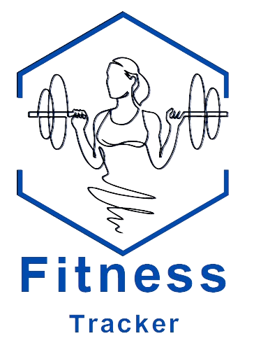
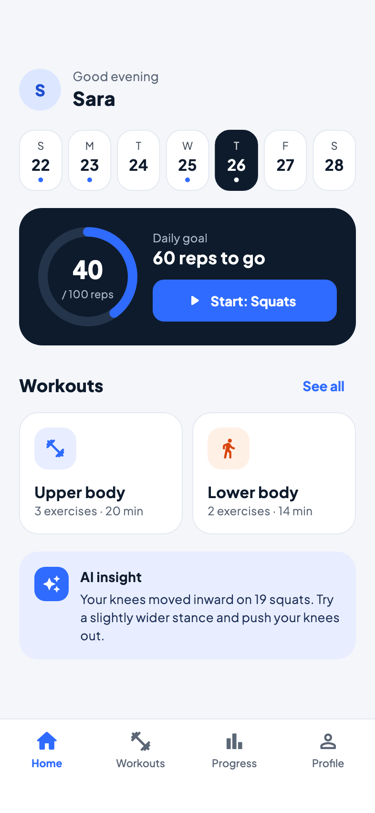
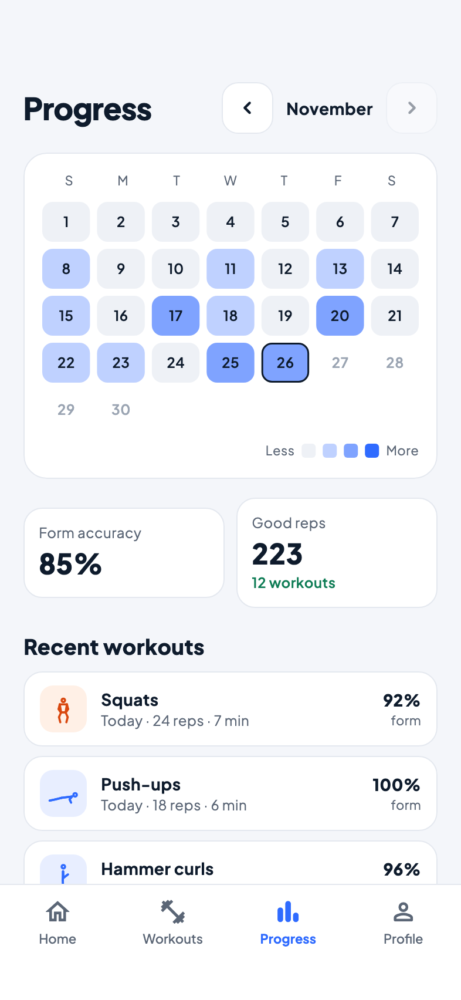
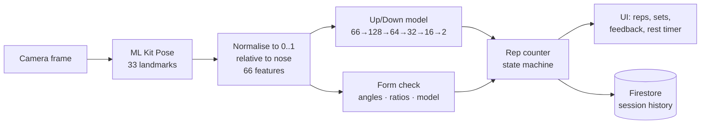

<div align="center">



# Fitness Tracker — AI Workout Coach

**Counts your reps and checks your form in real time using your phone's camera.**


</div>

> Graduation project (Taibah University, 2024), rebuilt as a cross-platform mobile app.

<!-- Add screenshots / a short GIF here — it's the first thing recruiters look at.
<p align="center">
  
  
  
</p>
-->

## Features

- 🎥 **Live pose tracking** — on-device body tracking (33 landmarks) with a skeleton overlay.
- 🔢 **Automatic rep counting** — custom-trained neural networks detect the up/down phase of each exercise.
- ✅ **Form feedback** — green/red skeleton and coaching cues (“Keep your elbow close to your body”, “Knees caving in”).
- 🏋️ **4 exercises** — push-ups, squats, hammer curls, barbell curls.
- 📶 **3 levels** — Beginner (8 reps), Intermediate (12), Advanced (15) × 3 sets with automatic rest timer.
- 📊 **Progress** — monthly activity heat-map, form accuracy trend, history, streaks, calorie estimate (MET-based).
- 🗣️ **Voice coaching** — spoken rep counts and form cues (text-to-speech), so you never have to look at the screen.
- ⏸️ **Pause, skip rest, per-set breakdown** — and an AI insight after every workout.
- ✨ **Polished UI** — "Clarity" design system, staggered entrance animations, animated rings, count-ups and a live animated workout screen (respects the OS *Reduce motion* setting).
- 🔐 **Accounts** — Firebase Authentication, per-user data in Cloud Firestore with security rules.
- 🔒 **Privacy** — video is processed on the device and never uploaded.

## How it works



- The models were trained with **MediaPipe + Keras** on 389 curated images (see [`ml/`](ml/README.md)).
- Google **ML Kit** uses the same BlazePose landmark model, so the trained networks work unchanged on mobile.
- The networks are tiny (~19k parameters) so they run in **pure Dart** — no native TFLite setup needed.
  Unit tests verify that the Dart output matches the original Keras weights.

## Tech stack

| Layer          | Technology |
|----------------|-----------|
| App            | Flutter (Android & iOS), Material 3, custom design system & motion |
| Pose detection | `google_mlkit_pose_detection`, `camera` |
| Voice          | `flutter_tts` |
| ML             | Python, MediaPipe, Keras (training) → JSON weights → Dart inference |
| Backend        | Firebase Authentication, Cloud Firestore |
| Quality        | Unit tests, `flutter analyze`, GitHub Actions CI |

## Project structure

```
lib/
├── main.dart
├── core/          theme (design tokens), motion (animations), validators
├── models/        Exercise, UserProfile, WorkoutSession, stats + insights
├── services/      AuthService, UserRepository (Firestore), VoiceCoach (TTS)
├── ml/            pose classifier, form analyzers, workout engine, camera → pose
├── screens/       auth, home, workout (live camera), report, profile
└── widgets/       shared UI kit, animated pose illustrations, camera overlay
ml/                original models + training code (Python)
tools/             convert_models.py (Keras .h5 → JSON)
test/              model + rep-counter unit tests
firestore.rules    database security rules
```

## Getting started

### Prerequisites
- [Flutter SDK](https://docs.flutter.dev/get-started/install) (stable, 3.27+)
- Android Studio (Android) and/or Xcode (iOS)
- A **physical device** — pose detection needs a real camera (ML Kit doesn't run on most simulators).

### 1. Clone & generate platform folders
```bash
git clone https://github.com/<your-username>/fitness-tracker.git
cd fitness-tracker
bash scripts/setup_platforms.sh com.<yourname>
flutter pub get
```
The script runs `flutter create` and applies the required settings
(Android `minSdk 23` + text-to-speech query, iOS camera permission + iOS 15.5). Prefer doing it by hand? See *Manual platform settings* below.

### 2. Firebase setup (your own project)
1. Create a project in the [Firebase console](https://console.firebase.google.com/).
2. **Authentication → Sign-in method →** enable *Email/Password*.
3. **Firestore Database →** create a database (production mode).
4. Connect the app:
   ```bash
   npm install -g firebase-tools && firebase login
   dart pub global activate flutterfire_cli
   flutterfire configure      # generates lib/firebase_options.dart
   ```
5. Deploy the security rules:
   ```bash
   firebase init firestore    # keep the existing firestore.rules
   firebase deploy --only firestore:rules
   ```
`lib/firebase_options.dart` and the Google service files are git-ignored, so your config stays out of the repo.

### 3. Run
```bash
flutter run
```

### Manual platform settings
- **Android** – in `android/app/build.gradle(.kts)` set `minSdk = 23`, and for voice coaching on Android 11+ add inside `<manifest>` in `AndroidManifest.xml`:
  ```xml
  <queries>
    <intent><action android:name="android.intent.action.TTS_SERVICE" /></intent>
  </queries>
  ```
- **iOS** – in `ios/Runner/Info.plist` add:
  ```xml
  <key>NSCameraUsageDescription</key>
  <string>The camera is used to detect your body pose and count your reps.</string>
  ```
  In `ios/Podfile` set `platform :ios, '15.5'`, and set *Minimum Deployments* to 15.5 in Xcode.

## Design

The UI follows the **Clarity** design: light background, deep navy (from the original app) and an electric-blue accent, set in Plus Jakarta Sans.

| Token | Value |
|---|---|
| Background / Surface | `#F4F6FA` / `#FFFFFF` |
| Ink (text, navy cards) | `#0E1B2C` |
| Accent | `#2F6BFF` |
| Form issue | `#D9480F` |
| Success | `#0E7C55` |

Motion: screens fade up 16 px with a 60 ms stagger, rings and bars fill from zero, numbers count up, buttons scale to 97 % on press. All motion is disabled when the OS *Reduce motion* setting is on.

## Tests
```bash
flutter test
```
- `pose_classifier_test` – Dart network output equals the NumPy/Keras reference for all 5 models.
- `workout_engine_test` – rep counting, wrong-form reps, countdown, rest, pause/resume, skip rest, per-set results, early finish, form analyzers.

## What changed from the original version (v1 → v2)

| v1 (graduation demo) | v2 (this repo) |
|---|---|
| Python desktop app (KivyMD + OpenCV window) | Native-feeling mobile app (Flutter, Android + iOS) |
| MediaPipe + Keras at runtime | ML Kit + same models running in pure Dart |
| Firebase **Admin** SDK with service-account key inside the app | Client SDK only; Firebase Auth handles passwords |
| SHA-256 password hashes stored in the database | No passwords stored by the app |
| Shared report node — every user overwrote the same calories | Per-user session history with Firestore rules |
| Single 4,400-line file, Windows-only paths | Layered architecture, unit tests, CI |

## Roadmap
- [ ] Arabic localisation (RTL)
- [ ] More exercises (lunges, shoulder press, plank timer)
- [ ] Sequence model (landmark windows) for more robust counting
- [ ] Custom workout plans & reminders

## Team & credits

Original graduation project — *“A Live Capture Tracking Model for Fitness Workouts using Vision Framework”*,
College of Computer Science and Engineering, **Taibah University** (2024), supervised by
**Dr. Aeshah Alsughayyir**.

Team: Anfal Alraddadi · Asma Alharbi · Reem Alruwaythi · Renad Alhazmi · Manar Alahmadi

Mobile rebuild (v2): **<your-name>** — [LinkedIn](https://linkedin.com/in/<your-handle>)

Font: [Plus Jakarta Sans](https://github.com/tokotype/PlusJakartaSans) (SIL Open Font License, see `assets/fonts/OFL.txt`).
